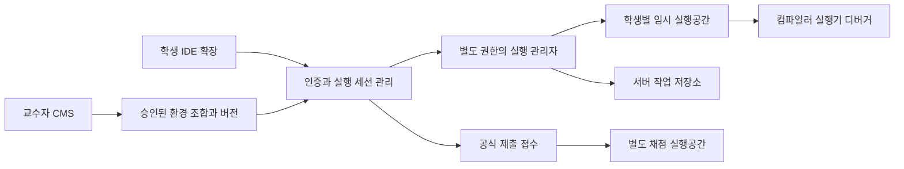

# 학생별 실행공간과 개발도구 모듈 설계

2026-10-28 · 전체 모듈 조합 설계와 C/C++/Python 구현의 경계를 구분한다.

현재 구현은 선택형 원격 Linux worker, 현재 코드 저장본 기반 C17/C++17 빌드·실행과 Python 3 실행,
저장 확인 후 공간 삭제, IDE 0.5.18 화면과 역할별 포털 상태 조회까지 연결한다. SQLite와 공식 제출·채점을
유지한다. [실행·검증 안내](../operations/remote-learning-runtime.md)를 따른다.
Python은 진입 파일 1개와 같은 저장본의 프로젝트 모듈·표준 라이브러리를 지원한다.
아래 Java·debugger·추가 패키지·임의 환경 조합·로컬 VM 제공자와 전체 SES Host는 후속 설계다.
운영 서버에는 별도로 worker와 승인 이미지·CSV 설정을 적용해야 한다.

학생에게 수업·과제별 임시 실행공간을 배정하고 C, C++, Java, Python의 개발도구를 기능별로
조합한다. 학생은 IDE에서 환경 준비·빌드·실행·디버깅을 수행하며, 정상 종료에서는 서버 작업
저장을 확인한 뒤 실행공간을 없앤다. 서버 작업 저장본·공식 제출본·성적은 각 보관 정책에 따라 남긴다.

학생 PC의 개발도구 설치를 최소화하기 위해 **원격 Linux 실행공간을 첫 구현 제공자**로 둔다.
기관 관리 로컬 VM과 Windows 실행공간은 동일 계약의 후속 대안이다. 기존 파일럿에 Docker를
강제 도입하거나 네이티브 IDE의 실행 방식을 즉시 교체하지 않는다. Python 서버·CSV·SQLite는 유지한다.

## 현재 구현과 추가 개발 범위

| 기능 | 현재 상태 | 추가 개발 |
| --- | --- | --- |
| 학생 작업·자료·IDE 프로필 | 공용 세션 폴더 분리와 종료·재시작 정리, 선택형 원격 Linux 공간·임대·삭제 확인 | 기관의 VM 제공자·실제 호스트 격리 인수 |
| 작업 저장 | 30초 변경 확인, 서버 Git 작업본 보관·복원, 실행 요청의 정확한 저장본 연결 | 원격에서 편집하는 파일의 양방향 동기화 |
| 승인 확장 | 수업별 VSIX 배포·해시·플랫폼 검사 | 개발도구 카탈로그, 의존성 해석, 조합 검증 |
| 환경 확인 | 기존 교수자 점검의 compiler는 `not_checked`; 별도 원격 화면에서 C/C++ 컴파일·실행과 Python 실행 | 언어별 debugger와 자동 사전 점검 |
| SES | 관리 v1 조합 미리보기, 전체 v2 Host는 미구현 | 실행공간 계약과 제품 조합 검증기 |

관련 구현은 `extensions/vscode/src/learningEnvironment.ts`, `extension.ts`, `managedExtensions.ts`,
`ide/code-oss/shared-session.mjs`와 서버 작업 저장 서비스다. 현재 폴더 분리는 OS 보안 격리가 아니다.
정확한 현재 종료 정책은 [공용 작업 저장 안내](../operations/shared-workspace-checkpoints.md)를 따른다.

## 실행 구조



IDE 확장은 버튼·상태·파일 전송·실행 및 디버거 연결을 담당한다. 실제 권한과 자원 제한,
실행공간 생성·파기는 실행 관리자가 강제한다. 학생 코드가 실행되는 공간에 API 서버의 DB,
서버 인증 토큰, 관리 소켓, 호스트 홈, 다른 학생 볼륨이나 비공개 채점 자료를 넣지 않는다.
학습 실행 결과는 성적 근거로 신뢰하지 않으며, 공식 제출은 불변 소스를 별도 채점 실행기로 보낸다.

| 실행 제공자 후보 | 학생 PC 준비 | 적용 범위와 제한 |
| --- | --- | --- |
| `execution.remote_linux` | Autograde IDE와 서버 연결 | 현재 C/C++/Python, Java는 후속. Linux 사용자 공간 실습. 네트워크 연결과 기관 실행 서버 필요 |
| `execution.local_linux_vm` | 기관이 준비한 VM 실행 관리자 | Mac/Linux/Windows에서 Linux 환경 제공. 로컬 오프라인 정책 별도 |
| `execution.managed_wsl2` | 기관이 준비한 WSL2와 격리 정책 | Windows의 Linux 실습. 공유 배포판·공유 계정만으로 학생 격리를 보장하지 않음 |
| `execution.windows_vm` | 원격 또는 기관 관리 Windows VM | MSVC·Windows SDK 기반 시스템 프로그래밍. Linux 이미지로 대체하지 않음 |

원격 Linux를 사용할 때 Mac은 편집·표시를 담당하므로 로컬 macOS SDK 없이 Linux 프로그램을
빌드할 수 있다. 결과는 Linux 실행 파일이며 Mac 네이티브 프로그램이 아니다. 커널 모듈·장치·
관리자 권한이 필요한 실습은 일반 컨테이너 프로필에서 거절하고 별도 검증된 VM 프로필로 분리한다.
로컬 컨테이너 방식도 Mac/Windows의 실행 기반을 미리 준비해야 하므로 VSIX만으로 완성되지 않는다.

## 기능별 플러그인 계약

다음 ID는 설계 후보이며 기존 CLI·CSV·관리 SES v1에 넣어 실행할 수 없다. 현재의 C/C++/Python
지원은 승인 이미지 하나의 고정 프로필이며, 이 표 전체의 모듈 조합을 구현했다는 뜻은 아니다.
기능 선택 단위와 물리 배포 단위를 구분한다. 교수자는 기능을 조합하고, 시스템은 검증된 조합을
하나의 불변 환경 이미지 또는 패키지로 미리 만든다. 로그인할 때 임의 설치 스크립트를 실행하지 않는다.

| 기능 | 모듈 후보 | 선택과 의존성 |
| --- | --- | --- |
| 세션과 격리 | `environment.session`, `environment.isolation` | 필수. 인증된 학생·수업·과제·세션에 귀속 |
| C 컴파일 | `compiler.c` | 대상 플랫폼의 헤더·표준 라이브러리·링커 필수 |
| C++ 컴파일 | `compiler.cpp` | C++ 표준 라이브러리·ABI·링커 필수. C와 도구 패키지 공유 가능 |
| Java 컴파일 | `compiler.java` | JDK의 `javac`와 호환 `runtime.jvm` 필수 |
| Java 실행 | `runtime.jvm` | 승인 JVM 버전. 컴파일 대상 버전과 호환되어야 함 |
| Python 실행 | `runtime.python` | 고정 interpreter 필수. 별도 C/C++ 컴파일러는 기본 필수가 아님 |
| 네이티브 디버깅 | `debugger.native` | 승인 LLDB/GDB 계열과 DAP adapter, 해당 도구·대상 ABI 호환 |
| Java 디버깅 | `debugger.java` | JVM과 호환되는 Java debug adapter |
| Python 디버깅 | `debugger.python` | interpreter와 호환되는 debug adapter |
| 빌드 자동화 | `build.cmake`, `build.maven`, `build.gradle` | 수업에 따라 선택. 해당 언어·runtime 의존성 검사 |
| 편집 지원 | `editor.language`, `editor.formatter` | 자동완성·오류 표시·서식. 실행/컴파일과 별도 선택 |
| 공개 테스트 | `test.public` | 학생에게 공개한 테스트만 실행. 공식 채점과 분리 |
| 패키지 의존성 | `dependencies.locked` | 승인 저장소와 정확한 버전·해시 사용 |
| 작업 저장과 정리 | `workspace.checkpoint`, `workspace.cleanup` | 필수. 교수자가 제거할 수 없음 |

Java의 compiler/runtime은 논리적으로 나눠도 하나의 JDK 패키지로 공급할 수 있다. Python의
선택 라이브러리가 C 확장 빌드를 요구하면 승인된 wheel을 제공하거나 그 조합에 native 도구 의존성을
추가한다. 디버거는 선택 기능이며 비활성 상태에서는 IDE와 서버 모두 실행 요청을 거절한다.

도구 설치 모듈은 Dev Container Features와 같은 구성 단위를 참고하되, 승인된 빌드 과정에서만
사용한다. 학생이 가져온 `devcontainer.json`, Dockerfile, 설치 스크립트가 실행 관리자나 이미지
빌드 서버에서 실행되지 않게 한다. DAP로 IDE와 debugger를 연결할 수 있으나 인증·프로세스 소유권은
DAP 자체가 대신하지 않는다. Microsoft 전용 Remote 확장의 Code-OSS 재배포를 전제하지 않는다.

## SES 조합과 환경 공개

개념적인 체계요소구조는 다음과 같다. 아직 schema나 실행 가능한 설정 파일은 아니다.

```text
LearningEnvironment
  SessionPolicy             필수: 소유권, 자원 한도, 저장, 정리
  ExecutionProvider         하나 선택: remote_linux / local_linux_vm / managed_wsl2 / windows_vm
  LanguageProfiles          하나 이상 선택
    C                       compiler + native runtime libraries
    C++                     compiler + C++ runtime libraries
    Java                    compiler + JVM
    Python                  interpreter
  OptionalCapabilities      각 언어와 호환되는 debugger / build / editor / public tests
  DependencyPolicy          버전 고정, 네트워크 허용 범위
```

기관 관리자가 패키지를 승인하고 교수자는 승인된 기능 조합을 선택한다. CMS의 흐름은
`환경 초안 → 기능 선택 → 호환성 검사 → 시험 실행 → 공개 → 과제 연결`이다.
과제에는 환경 ID·버전뿐 아니라 OS/CPU, SDK/ABI, 도구·의존성 digest, 실행 정책과 구성 lock을
고정한다. 채점 환경과 학생 환경의 언어 표준·컴파일 옵션·런타임 버전도 함께 검증한다.
실습 중인 환경을 자동 교체하지 않으며, 새 버전은 새 세션에 적용한다. 이전 구성은 원본 이력과 연결한다.

거절할 조합에는 JVM 없는 Java 컴파일, interpreter 없는 Python debug, Linux 실행기에 Windows SDK
과제 연결, 지원하지 않는 CPU/ABI, 누락·변조 패키지, 필수 저장/정리 제거가 포함된다.
버전·대상별 Hello World 성공만으로 전체 조합을 승인하지 않으며 디버깅·의존성·격리도 검사한다.
현행 [SES 제품군 설계](software-product-line.md)의 지원 조합·lock 원칙을 재사용하고,
[관리 SES](management-ses.md)의 기존 6개 모듈을 변경하지 않는다.

## 학생 사용과 저장 및 삭제

학생 화면의 주 행동은 `환경 준비`, `실행`, `디버깅`, `제출`, `실습 종료`다.
환경 버전·마지막 서버 저장 시각·저장 대기·오류·재연결 여부를 표시한다. 컴파일이 필요한 언어는
실행 전에 빌드하고, 실패하면 파일·행·오류 내용을 보여준다. Python에는 불필요한 컴파일 버튼을 강제하지 않는다.
추가 언어·도구를 과제 진행 중 임의로 설치하는 대신 교수자에게 승인 요청을 제공한다.

정상 종료의 목표 순서는 다음과 같다.

1. 새 실행·제출·추가 편집 요청을 막고, 진행 중인 편집 저장·전송을 완료한다. 실패하면 종료 준비를 중단한다.
2. 실행·debug·동기화 등 파일을 쓰는 프로세스를 모두 중지하고 쓰기 차단을 확인한다. 그 뒤 불변 소스 snapshot과 manifest를 확정하여 서버에 저장한다.
3. 서버가 저장한 checkpoint ID와 digest가 확정 snapshot과 일치하는지 확인한다. 단순 전송 시작이나 로컬 Git commit을 저장 완료로 표시하지 않는다.
4. 실행 채널·세션 임대를 회수하고 프로세스·작업 볼륨·학생별 캐시·로컬 프로필·토큰을 정리한다.
5. 삭제를 확인한 뒤 종료 완료를 표시한다. 재실행하면 새 공간에 본인의 서버 저장본을 복원한다.

실행공간 삭제는 서버 작업본·공식 제출·성적 삭제가 아니다. 공식 제출은 별도의 접수 ID와 불변
snapshot을 사용한다. 종료와 제출이 겹치면 서버가 소스 접수를 확정한 뒤 공간을 지우며, 채점은
접수된 snapshot으로 계속한다. 단순 실행·자동 저장으로 공식 제출을 만들지 않는다.

| 상황 | 처리 원칙 |
| --- | --- |
| 정상 종료 중 저장 실패 | 성공으로 표시하지 않고 재시도·내보내기·종료 취소 제공 |
| 원격 연결 단절 | 즉시 실습 종료로 해석하지 않음. 임대 만료 후 접근 회수, 프로세스 정지, 관리자가 정한 유예 기간 동안 본인 복원만 허용 |
| 원격 저장소 장애 | 정지된 전용 볼륨을 다른 학생과 공유하지 않고 제한 기간 격리 보관. 유예 만료 정책과 미저장 손실 상태 기록 |
| IDE 강제 종료·좌석 교체 | 로컬 잔여 파일과 인증 정리를 우선. 저장 확인된 버전까지만 복원 보장 |
| 로컬 오프라인 | 보호된 VM 볼륨의 보존은 별도 정책. 같은 OS 계정이 읽을 수 있는 평문 폴더를 복구용으로 방치하지 않음 |
| 정리 실패 | `cleanup_failed` 표시, 같은 공간/좌석 재사용 차단, 소유권 확인 후 제한된 재시도 |
| 동일 학생의 두 IDE | 실행공간당 쓰기 임대 하나. 이어받기는 이전 쓰기 차단을 확인한 뒤 허용 |
| 서버 또는 실행 관리자 재시작 | 내구성 임대·자원 ID를 실제 프로세스/볼륨과 대조하고 고아 자원 정리. 요청 ID로 생성·종료 중복 방지 |

유예 기간·유휴 만료·최대 실습 시간은 환경 공개 전에 운영자가 반드시 정한다. 무기한 보관은
허용하지 않으며, 유휴 여부는 heartbeat만이 아니라 활성 작업·debug 상태도 고려한다.
개인정보를 즉시 지우면서 오프라인의 미전송 변경을 반드시 복구하는 두 요구를 동시에 보장할 수는 없다.
첫 구현은 IDE의 명시적 종료에 서버 저장·원격 삭제 확인을 연결한다. 강제 종료는 기존 로컬
정리와 원격 임대 만료에 의존한다. 읽기 전용 원격 소스를 사용하므로 원격 생성 파일은 작업본에
포함하지 않으며, 보존하려는 코드는 IDE의 로컬 과제 폴더에서 편집한다.

승인된 읽기 전용 도구 이미지와 학생 데이터 캐시를 구분한다. 공유 도구에는 코드·로그·토큰·
학생이 설치한 패키지를 쓰지 않는다. 빌드 산출물과 pip/Maven 등의 쓰기 캐시는 학생 세션 소유로 두고
삭제한다. 삭제는 정상 접근 경로에서 제거되었음을 의미하며 저장 매체의 포렌식 소거 보장과 구분한다.

## 격리와 교수자 모니터링

CPU·메모리·프로세스 수·디스크·실행 시간·출력 크기·네트워크 허용 범위를 필수 제한으로 둔다.
학생 프로세스에는 비특권 사용자, 전용 파일·프로세스 경계, 제한된 시스템 호출 정책을 적용한다.
일반 Linux 컨테이너는 커널을 공유하므로 VM과 같은 경계로 표시하지 않는다. 기관의 위협 모델과
수업 요구에 따라 강화된 컨테이너 또는 VM을 선택하고 실제 탈출·교차 접근 시험을 통과해야 한다.
실행 권한을 관리하는 프로세스를 API/SQLite와 분리하고, API 요청으로 임의 이미지·호스트 경로·
권한 플래그를 전달할 수 없게 한다. 컨테이너 엔진 관리 소켓은 학생 공간에 제공하지 않는다.

디버거 포트를 외부에 직접 열지 않는다. 짧은 수명의 세션 권한을 확인한 채널을 통해 본인의
프로세스만 조작한다. DAP의 attach·파일 접근·실행 요청을 검증하고 native debug를 위해 전체
privileged 모드나 호스트 PID 접근을 허용하지 않는다. 추가 권한이 필요한 경우 해당 제공자에서
검증한 debug 전용 정책만 사용한다. 불가능하면 조용히 권한을 넓히지 않고 기능 미지원으로 표시한다.

임대 갱신·재연결·파일 접근·실행·debug 요청마다 현재 학생 상태와 수강·과제 권한을 재확인한다.
수강 취소·학생 비활성·세션 폐기 시 임대의 만료 시각까지 기다리지 않고 채널 종료·쓰기 차단·
프로세스 정지를 강제한다. 권한 상태를 확인할 수 없으면 새 접근을 거절하고, 실행 관리자는
회수 신호 또는 제한된 임대 만료로 중지한다. 중지된 공간은 유효한 새 인증·인가 없이 복원하지 않는다.

교수자 학생 카드에는 `준비 중 / 사용 가능 / 실행 중 / 연결 끊김 / 저장 오류 / 정리 오류`를
표시하고 상세 팝업에 환경 버전, 마지막 저장, 실행·제출 이력, 오류와 재시도 상태를 연결한다.
이벤트는 서버에서 학생·수업 권한을 확인한 스트림으로 전달한다. 연결 단절을 부정행위나 미참여로
자동 판정하지 않는다. 저장·실행·제출 등 학습 기능의 사건을 기록하며 키 입력·화면을 수집하지 않는다.
실행공간의 네트워크 제한만으로 학생 PC 전체의 외부 AI 사용이 차단되는 것은 아니다.

## 구현 순서와 인수 기준

1. **구성 모델:** 승인 모듈·의존성·환경 lock·호환성 검증과 CMS 초안/시험/공개를 구현한다.
2. **Mac 클라이언트와 원격 Linux — 구현:** C/C++ 및 Python 환경으로 배정·복원·실행·저장·파기를 연결했다.
   C/C++은 빌드 후 실행하고 Python은 진입 파일 1개를 실행한다. Python 오류·시간 및 출력 제한도 검증했다.
3. **추가 언어와 의존성:** Java의 승인 JDK, Python 추가 패키지 등 고정 의존성, 언어별 공개 테스트를 추가한다.
4. **디버깅:** DAP 채널, 소유권 검사, 중단점·변수·단계 실행·종료 처리를 언어별로 검증한다.
5. **Windows와 WSL2:** 같은 원격 흐름을 Windows 클라이언트에서 검증하고 로컬 제공자와 Windows 전용 실습을 별도 인수한다.

20명 이상 수업을 목표로 하되 장비 사양만으로 지원을 선언하지 않는다. 현재는 25개 합성 학생의
독립 공간에서 최대 5개 API 요청·worker 실행 한도 4개로 실행·저장·종료를 확인했다.
이는 제한된 부하 시험이며 25개 프로그램의 동시 실행이나 기관 서버 수용 인원 인증이 아니다.
실제 측정은 [검증 기록](../testing/remote-learning-runtime.md)을 따른다. Java VM·debug와 지속 부하는
해당 기능을 구현한 뒤 별도로 측정한다. 웹 조회 부하 시험은 실행공간 성능 검증을 대신하지 않는다.

필수 시험은 언어별 표준입출력·컴파일 오류·중단점·무한 루프·메모리 초과·프로세스 폭증,
두 학생 간 파일/토큰/debug 접근 거절, 공개 테스트와 비공개 채점 분리, 연결 단절·강제 종료·
서버 재시작·중복 생성·준비 취소·저장 후 파기·미저장 종료·제출 경합·정리 실패·다음 학생 시작,
변조 패키지·미지원 조합·이전 환경 복원이다. 통과 전에는 실제 학생의 격리 환경으로 공개하지 않는다.

## 근거

- [Dev Container Features](https://containers.dev/guide/author-a-feature): 기능별 설치·구성 묶음과 사설 OCI 배포를 참고한다. 이 문서의 SES 계약이나 운영 승인을 대신하지 않는다.
- [Debug Adapter Protocol](https://microsoft.github.io/debug-adapter-protocol/overview.html): IDE와 debugger 통신을 분리하는 표준이다. 인증·실행공간 생성은 별도 책임이다.
- [Docker Engine security](https://docs.docker.com/engine/security/): namespace·자원 제한·관리 API·권한 설정을 함께 고려한다.
- [Mac 실행 기반 설치](https://docs.docker.com/desktop/setup/install/mac-install/), [Windows 실행 기반 설치](https://docs.docker.com/desktop/setup/install/windows-install/): 로컬 방식에는 운영체제별 실행 기반 준비가 필요하다.
