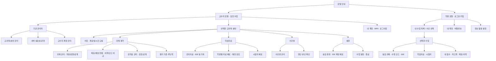

# Autograde 포털 Information Architecture Map

기준: 2026-11-13. 교수자·학생의 작업 목적, 현재 수업, 상위 화면을 모든 화면에서 확인할 수 있게 한다.

## 전체 구조

## 교수자 메뉴 계약

`src/autograde/instructor_navigation.py`가 교수자 메뉴 순서·이름·기능 활성 조건의 원본이다. Python 화면과 Next.js의 인증 bootstrap은 같은 정의를 사용한다. 클라이언트가 임의로 선택 기능이나 관리자 메뉴를 추가하지 않는다. 메뉴 표시 여부는 권한 검사를 대체하지 않는다.

`B = /courses/{course_key}/instructor`. 수업 키는 인증된 교과목 목록에서만 선택한다.

| 그룹 | 메뉴 | 기본 경로 | 표시 조건 |
|---|---|---|---|
| 수업 | 수업 개요 / 실습 교실 | B / B/classroom | 담당 수업 |
| 과제·평가 | 과제 관리 | B/assignments | 과제 편집 서비스 |
| 과제·평가 | 제출·채점 현황 | B/submissions | 담당 수업 |
| 과제·평가 | 성적표 관리 / 평가 기준·루브릭 | B/gradebook / B/rubrics | 각 서비스 활성 |
| 학습자료 | 강의자료 / 학생별 자료 배포 / 시험지 배포 | B/content / B/materials / B/exam-papers | 각 서비스 활성 |
| 수강생 | 수강생 관리 / 명단·본인 확인 | B/students / B/registrations | 담당 수업 |
| 설정 | 실습 환경 / IDE 확장 배포 / 수업 설정 | B/environments / B/extensions / B/settings | IDE 배포는 해당 서비스 활성 |
| 포털 | 교과목·분반 관리 / 서버·실습실 운영 | /instructor/admin / /instructor/operations | 관리자, 운영 서비스 활성 |
| 계정 | 내 계정·로그아웃 / 교수자 계정 관리 | /instructor/account / /instructor/accounts | 개인 인증 활성, 계정 관리는 관리자 |

Next.js 제출 화면은 `/app?course_key=...`, 교실 화면은 `/app/classroom?course_key=...`를 사용한다. 두 화면은 같은 과제·수업 문맥을 유지하며 메뉴 이름·순서·사용 가능한 기능은 서버 계약을 따른다. 서버가 구버전인 경우 기존 기본 메뉴만 제공하며, 선택 기능은 추측하지 않는다. 학생 포털 진입 링크는 서버가 제공하는 `/student`를 사용한다.

## 돌아가기와 현재 위치

- 모든 교수자 공통 화면: 상단에 `상위 화면으로 돌아가기`와 breadcrumb를 제공한다. 깊은 링크로 직접 접속해도 동작한다.
- 목록 → 수업 개요 → 교수자 포털 → 포털 안내 순으로 돌아간다.
- 과제 상세·초안·검증 → 과제 목록. 초안 다운로드 등 하위 작업 → 해당 초안.
- 성적표 검토 → 성적표 목록. 자료 배포 상세 → 자료 목록. 일괄 업로드 검토 → 해당 자료 상세.
- 제출 코드·비교 → 해당 제출 이력 → 제출·채점 현황.
- 관리자 교과목 상세 → 교과목·분반 관리. 운영 하위 화면 → 서버·실습실 운영.
- 400/403/404 오류 화면도 요청의 수업과 메뉴 문맥을 유지한다. 알 수 없는 경로는 수업 개요 또는 교수자 포털로 돌아간다.
- 학생 수업 화면 → 내 수업 목록. 과제·점수·자료 → 내 수업. 회원·오류 화면에는 학생 포털 복귀 경로를 제공한다.
- 계정·MFA 화면은 인증 전 수업 데이터를 조회하지 않고 계정/포털로 돌아가는 경로만 제공한다.
- `history.back()`이나 임의의 외부 `return_to`를 사용하지 않는다. POST·삭제·다운로드 주소를 상위 화면으로 사용하지 않는다. 상위 목록 링크는 기본 목록을 열며 이전 검색 조건을 복원하지는 않는다.

## 먼저 개선하는 작업 흐름

### 성적 공개

엑셀 업로드 → 학번·전체 행 검토(검색/페이지) → 공개 항목 명시 선택 → 선택 항목만 학생 미리보기 → 현재 공개본과 신규/변경/제외 비교 → 확인 후 공개.

새로 가져온 열은 자동 공개 대상으로 선택하지 않는다. 교수자 검토용 표와 학생에게 공개될 표를 구분한다. 공개본 교체로 빠지는 학생은 명시적으로 알려준다.

### 과제 저장 복구

편집 → 저장 중 → 저장 완료 / 저장 상태 불확실 → 서버 저장 상태 확인 → 저장 확인 / 안전한 재시도 / 다른 변경 비교.

응답이 오지 않았다는 이유로 저장 실패를 단정하지 않는다. 요청 식별자와 서버 버전으로 확인하며, 다른 편집자의 내용을 조용히 덮어쓰지 않는다. 입력과 선택 파일은 현재 탭에 보존하고 로그인 정보나 학생 데이터를 브라우저 영구 저장소에 보관하지 않는다.

### 학생별 자료 ZIP 등록

파일 선택 → 업로드 진행 → 파일·용량·학번 검사 → 비공개 학생별 매칭 검토 → 확인 후 적용.

공개 중인 자료도 확인 전까지 바뀌지 않는다. 신규/교체 대상, 파일명, 학번, 이름을 검토한다. 검토 이후 원본이 바뀌면 다시 검토한다. 취소/만료된 검토본으로 반영할 수 없다. 무제한 압축 해제를 허용하지 않으며 오류에는 문제 파일과 제한 기준을 제공한다.

## 검증 기준

- HTML과 JSON 메뉴가 같은 기능 설정·권한에서 같은 목적지를 제공한다.
- 다른 수업·외부 URL·변경 실행 경로를 메뉴/복귀 링크로 받지 않는다.
- 100명을 넘는 성적표도 모든 행을 검토할 수 있고, 미선택 열은 공개되지 않는다.
- 저장 전 연결 실패, 저장 후 응답 유실, 다른 탭 편집을 구분해 복구한다.
- 공개 자료 일괄 교체는 검토 전 변경되지 않으며 오래된 검토본은 반영을 거절한다.
- 375px 화면에서 주요 버튼·메뉴와 상태가 화면 밖으로 밀리지 않는다.

화면 이동을 하나의 공통 구조로 정리하는 단계다. 자료 유형별 내부 저장 방식의 통합, 대시보드 작업 목록 재설계, 기관별 메뉴 사용자 정의는 별도 단계이며 이번 변경으로 구현되었다고 간주하지 않는다.
