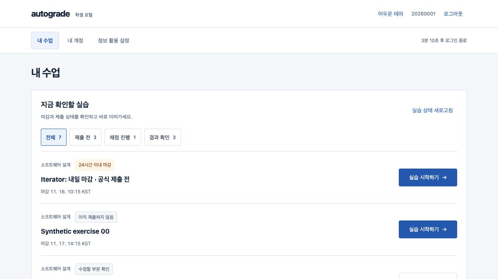
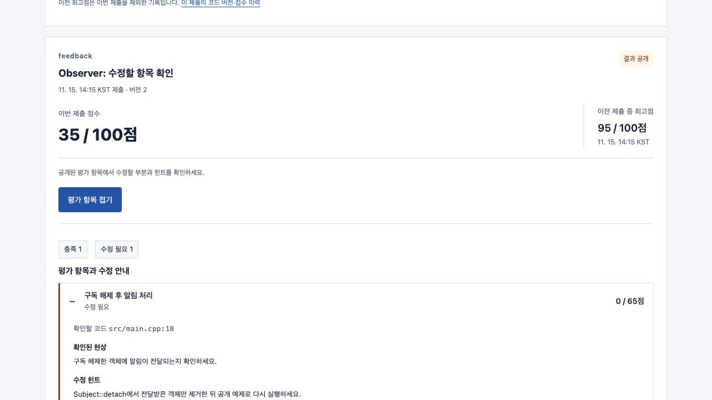

# 학생 포털 작업 흐름 개선 검증 · 2026-11-15

## 적용한 변화

| 작업 | 변경 전 | 변경 후 |
|---|---|---|
| 실습 시작 | 수업에 들어가 과제 탐색 | 홈의 마감·제출 상태에서 해당 과제로 바로 이동 |
| 화면 이동 | 전역/수업 메뉴와 돌아가기 중복 | 전역 메뉴와 수업 탭 분리, 수업 목록 복귀 하나 |
| 자료 받기 | 자료 메뉴 → 기존 웹 자료함 → 파일 | Next.js 파일 목록에서 PDF·ZIP 직접 다운로드 |
| 결과 확인 | 성적표·안내 뒤에서 실습 점수 탐색 | 최신 제출 우선, 이번 점수 강조, 이전 최고점 보조 표시 |
| 수정 방향 | 자세한 결과는 IDE에서 확인 | 공개된 평가 항목·코드 위치·수정 힌트를 웹에서 확인 |

시험·출석 성적은 내 점수 화면의 별도 선택으로 제공한다. 선택적 정보 활용 설정과 계정 관리는 독립 메뉴로 유지한다.
제출 이력과 이용 안내는 기본으로 접는다. 일반 로그인 성공 알림과 반복되는 상단 설명을 줄여 실제 작업을 먼저 보여준다.

## 자동 검증

- 웹 전체 시험 118개: 계약 검증, 실제 React 화면, 공개 점수, 자료 버전 충돌, 이전 응답 폐기, 필터/브라우저 뒤로가기/과제 직접 연결 포함.
- 신규 Python HTTP 시험 16개: 홈의 본인 수업 제한, 공개 피드백, `score_only`, 타인·다른 수업 차단, PDF·ZIP·공통 PDF의 실제 바이트, CSRF/Origin, 비밀번호 교체, 파일 버전 충돌, 응답 크기 제한.
- 기존 Python HTTP 회귀 123개 실행 통과(이 실행에는 신규 시험 중 초기 12개가 포함됨). 추가 경계 시험을 포함한 신규 16개도 별도로 통과했다.
- 합성 검증 환경 단위 시험 2개 통과. TypeScript 검사와 Node.js 26의 Next.js 운영 빌드 통과.

```sh
cd web
npm test
npm run typecheck
npm run build
```

```sh
python -m pytest tests/integration/test_student_workbench_api.py tests/unit/test_student_portal_fixture.py -q
```

## 실제 브라우저 검증

운영 서버 대신 임시 SQLite·Python 서버·운영 빌드 Next.js를 연결한 loopback 환경에서 합성 학생으로 확인했다.

1. 기존 6자리 수업 비밀번호로 로그인하고 개인정보 활용 팝업에서 나중에 선택.
2. 홈의 실습 상태와 마감 표시, 선택한 실습으로 직접 이동·수령 코드 발급·코드 지우기 확인.
3. 자료 목록에서 실제 PDF·ZIP 다운로드. URL이 자료 화면에 유지되고 저장 결과는 브라우저 다운로드 목록에서 확인.
4. 배포 예정·종료 자료의 다운로드 비활성화, 다른 학생 자료 미표시 확인.
5. 최신 35/100점과 이전 최고 95/100점 구분, 실패 항목·코드 위치·수정 힌트 표시 확인.
6. 새 제출이 채점 대기일 때 이번 점수 미확정과 이전 최고 80점 구분 확인.
7. 점수만 공개된 과제는 상세 설명을 만들지 않고 공개 범위 안내. 교수자 성적의 중간 72점·기말 미입력·출석 9.5점 확인.
8. 375px 폭의 밝은/어두운 화면 점검. 자료 버튼이 화면을 넘던 문제를 수정한 뒤 홈·자료·결과의 가로 넘침이 없음을 확인.
9. 로그아웃 후 학번·수령 코드·성적 화면이 제거되고 로그인 화면으로 복귀.

검증 중 추가 수정: 마감된 과제의 제출 권유 문구, 조회 범위에서 빠진 제출을 미제출로 오인하는 표시,
홈 과제 선택 후 이전 필터 때문에 목적 과제가 숨는 현상, 새로고침 후 목적 과제 포커스 누락.

## 확인 화면

모든 이름·학번·점수·파일은 합성 검증 자료다.





[모바일 자료 목록](assets/student-workbench-2026-11-15/mobile-materials.jpg) · [모바일 어두운 결과 화면](assets/student-workbench-2026-11-15/mobile-results.jpg)

## 적용 범위와 남은 검증

운영 서버 반영이나 실제 학생 대상 사용성 실험은 수행하지 않았다. 코드 적용 후 Python 서버 재시작과 Next.js 재빌드가 필요하다.
이 변경에 DB 초기화·학생 명단 재등록은 필요하지 않다. Git 강의 콘텐츠의 IDE 동기화는 기존 기능이며 이번 파일 목록과 별개다.
실제 학생에게 설명 없이 과제 선택·자료 다운로드·실패 항목 찾기를 수행하게 하여 성공률·소요 시간·혼동 지점을 확인하는 검증은 별도로 필요하다.
